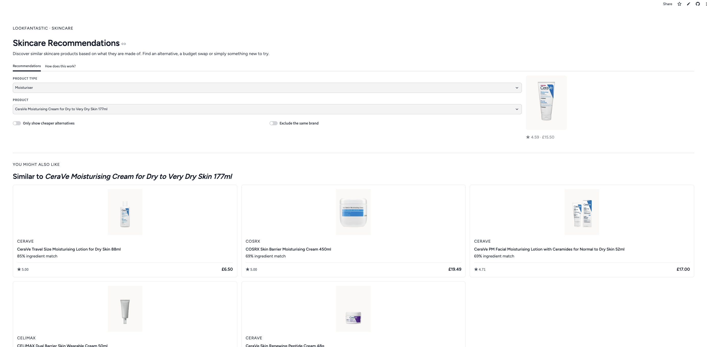

# Skincare Product Recommender

Find skincare products with a similar formula. Pick a product and the app shows up to five similar products of the same type. You can also look for cheaper alternatives or other brands.

**Live app:** [mk-skincare-recommendation.streamlit.app](https://mk-skincare-recommendation.streamlit.app/)



The project has three parts:

1. **A data pipeline** that keeps a catalogue of Lookfantastic products up to date, with data quality checks and a weekly schedule.
2. **A recommender** that matches products on their ingredient lists.
3. **An evaluation** that tests the recommender against a random baseline and published dupe pairs.

## Features

- **Ingredient matching.** Products are compared on their full ingredient lists. Ingredients listed first carry more weight.
- **Ingredient families.** Related ingredients such as sodium hyaluronate and hyaluronic acid get partial credit.
- **Dupe finder.** Show only products that cost less than the one you picked.
- **Other brands only.** Hide products from the same brand.
- **Transparent results.** Each card shows its ingredient match, rating and price with a link to the product page.
- **One listing per product.** Other sizes of the product you picked are hidden. Each result appears once.

## How it works

Every product is compared with all other products of the same type. Each candidate gets a score from three signals.

| Signal | Weight | What it measures |
|---|---|---|
| Ingredient match | 75% | How similar the two formulas are |
| Price | 15% | Similar price by default. In dupe mode a bigger saving scores higher. |
| Rating | 10% | Higher rated products score a little higher |

```
score = 0.75 × ingredient match + 0.15 × price + 0.10 × rating
```

**Ingredient match.** Each full ingredient name is one token. "Sodium hyaluronate" is matched as a whole and is never split into separate words. Water is ignored because nearly every product has it. Ingredient lists are ordered by concentration so the top five ingredients are repeated to give them more weight. TF-IDF then gives rare ingredients more weight than common ones like glycerin. Cosine similarity turns this into a score between 0 and 1.

**Ingredient families.** Fourteen families group related ingredients. Examples are hyaluronic acid, vitamin C, retinoids, ceramides, peptides, AHAs and BHAs. Each ingredient in a family adds a family token with the same weight as the ingredient. Exact matches still score highest. See [`ingredients.py`](ingredients.py).

**Similarity threshold.** A product needs an ingredient match of at least 0.1 to appear. Price and rating cannot push an unrelated product into the results.

**Missing ratings.** Products with no rating get the median rating for their product type.

**Size variants.** Many products are listed in more than one size. A product counts as another size when its name matches once sizes are removed, or when it has the same brand and an identical ingredient list. The same product never fills more than one slot. Identical lists from different brands are kept because those are true dupes.

## Evaluation

The full analysis is in [`notebooks/evaluation.ipynb`](notebooks/evaluation.ipynb). It runs on the full catalogue of 4,165 products and tests the model three ways against a random baseline.

**1. Size variants.** A product sold in two sizes has the same formula. The model finds the other size as its top match for 85% of products. Random picks would manage under 1%. Most misses are scent variants of one base formula, such as Rituals or Jo Malone ranges, which really are near-identical.


**2. Published dupes.** Five pairs from beauty editors and dupe finder sites are in the catalogue. The known alternative has a median rank of 31 among 500 to 900 products of its type. Random picks would give about 340. Three of the five are in the top 10%.

| Pair | Products of that type | Rank |
|---|---|---|
| Elemis Pro-Collagen Balm → Emma Hardie Moringa Balm | 492 | 6 |
| Estée Lauder Advanced Night Repair → Lancôme Génifique | 687 | 13 |
| First Aid Beauty Ultra Repair → CeraVe Moisturising Cream | 916 | 31 |
| Elemis Pro-Collagen Balm → Clinique Take The Day Off | 492 | 73 |
| Vichy Minéral 89 → The Ordinary Hyaluronic Acid | 687 | 595 |

The last pair does the same job with a different formula. Ingredient matching cannot see that link. Product claims as an extra signal are on the roadmap.

**3. Catalogue behaviour.**

| Check | Result |
|---|---|
| Products with at least one cheaper alternative | 92% |
| Median saving in dupe mode | 50% |
| Results that are another size of the same product | 0% (was 3.3%) |
| Results from the same brand | 27% (1.6% if random) |

Same-brand results are common because brands reuse base formulas across their ranges. The "Exclude the same brand" toggle covers this.

## Data pipeline

The app reads `data/skincare_products.csv`. The pipeline in [`pipeline/`](pipeline/) keeps it up to date.

```
category pages ──► discover new products ──┐
                                           ├──► fetch product pages ──► merge ──► quality checks ──► save
existing catalogue ──► re-check products ──┘
```

1. **Discover.** Reads Lookfantastic category pages for each product type and collects product links.
2. **Fetch.** Visits every known and newly found product page. It reads the name, brand, price, rating, review count, image, stock status and full ingredient list. Requests go one at a time with a pause between them.
3. **Merge.** Updates existing products, adds new ones and marks products whose page has gone as unavailable. Products are never deleted. Some sizes share one product page. For those, only fields that are the same for every size are updated.
4. **Check.** Runs data quality checks. If any check fails the catalogue is not saved. Every run writes [`data/quality_report.md`](data/quality_report.md).

| Check | Fails the run when |
|---|---|
| No duplicate products | Two rows share a product ID and name |
| No missing key fields | A product has no ID, name, link or type |
| Product types are known | A type is not one the app supports |
| Prices and ratings in range | A price is not between £0 and £1,000 or a rating is not between 0 and 5 |
| Ingredient coverage | Fewer than 90% of available products have ingredients |
| No products were lost | The catalogue has fewer rows than before |
| Most pages loaded | More than 20% of requests failed, for example if the site blocks the scraper |

Warnings cover short ingredient lists, missing brands, prices that change more than 3x and products still using 2021 ingredients.

**Cleaning built into the pipeline.**

- Pages are read as UTF-8, so names such as "Estée Lauder" keep their accents.
- Ingredient lists are tidied. Numbered chemicals such as "1,2-hexanediol" stay whole, label codes and footnotes are removed and lists separated by full stops are split.
- Brands come from the page or are matched from the start of the product name using [`data/brands.csv`](data/brands.csv).
- Gift sets, advent calendars and mixed bundles are flagged with `is_bundle` and hidden in the app. They have no single formula to match.
- A discontinued product's old link can redirect to a category page. Those products are marked unavailable rather than renamed.
- Products that move to a new Lookfantastic ID are followed instead of being added twice.

[`pipeline/repair.py`](pipeline/repair.py) applies the same cleaning to a saved catalogue without scraping again.

**Schedule.** [`.github/workflows/refresh-data.yml`](.github/workflows/refresh-data.yml) runs the pipeline every Monday. It runs the tests on the new data and commits the updated catalogue and report. It can also be started by hand from the Actions tab. A second workflow runs the tests on every push.

### Run the pipeline yourself

```bash
pip install -r requirements-pipeline.txt
python -m pipeline.run --limit 20 --no-discover   # quick test on 20 products
python -m pipeline.run                            # full refresh
python -m pipeline.repair                         # re-clean the saved catalogue, no scraping
```

## Data

The catalogue started from a 2021 [Kaggle](https://www.kaggle.com) dataset of 1,138 [Lookfantastic](https://www.lookfantastic.com) skincare products. The first full pipeline run in November 2026 grew it to 4,799 products and replaced the 2021 ingredient lists with current ones.

| | |
|---|---|
| Products in the catalogue | 4,799 |
| Shown in the app (available, not gift sets) | 4,165 |
| Gift sets and bundles (hidden) | 447 |
| Brands | 266 |
| Product types | 14 (Moisturiser, Serum, Cleanser, Body Wash, Mask and more) |
| Median ingredients per product | 29 |
| Ingredient lists from the 2026 scrape | 97% |

**File:** `data/skincare_products.csv`

| Column | Description |
|---|---|
| `product_id` | Lookfantastic product ID. Sizes that share a page share an ID. |
| `product_name` | Name of the product |
| `product_url` | Link to the product page |
| `product_type` | Category such as Moisturiser, Cleanser or Serum |
| `brand` | Brand name |
| `ingredients` | List of ingredients in order of concentration |
| `ingredients_source` | `kaggle_2021` or `lookfantastic` for scraped lists |
| `price` | Price when first seen (£) |
| `updated_price` | Latest price (£). Used in the app. |
| `price_change` | Difference between the two prices |
| `product_rating` | Average customer rating out of 5 |
| `review_count` | Number of reviews |
| `product_image_url` | Product image |
| `available` | Whether the product page still exists |
| `in_stock` | Whether the product was in stock at the last check |
| `is_bundle` | Gift sets and bundles, hidden in the app |
| `first_seen` / `last_checked` | When the product was added and last checked |

`data/skincare_products_2021.csv` and `data/skincare_products_2026.csv` are kept as history. [`notebooks/Skincare.ipynb`](notebooks/Skincare.ipynb) is the original 2026 refresh.

## Project structure

```
skincare_recommendation/
├── recommender.py                     # Streamlit app and recommendation logic
├── ingredients.py                     # Ingredient cleaning and families
├── pipeline/
│   ├── config.py                      # Categories, request settings, check thresholds
│   ├── parse.py                       # HTML parsing (no network)
│   ├── scrape.py                      # Polite fetching and product discovery
│   ├── merge.py                       # Combine scraped data with the catalogue
│   ├── checks.py                      # Data quality checks and report
│   ├── brands.py                      # Brand lookup from product names
│   ├── run.py                         # Command line entry point
│   ├── repair.py                      # Re-clean the saved catalogue without scraping
│   └── bootstrap.py                   # One-off conversion of the 2026 data
├── data/
│   ├── skincare_products.csv          # Catalogue used by the app
│   ├── quality_report.md              # Latest data quality report
│   ├── brands.csv                     # Known brands and the short names products use
│   ├── skincare_products_2026.csv     # 2026 refresh (history)
│   ├── skincare_products_2021.csv     # Original Kaggle dataset (history)
│   └── corrected_brands_dictionary.csv
├── notebooks/
│   ├── evaluation.ipynb               # Model evaluation
│   └── Skincare.ipynb                 # Original 2026 data refresh
├── tests/
│   ├── test_recommender.py
│   ├── test_pipeline.py
│   └── fixtures/                      # Saved pages used by the pipeline tests
├── docs/
│   └── evaluation_size_variants.png
├── .github/workflows/
│   ├── refresh-data.yml               # Weekly data refresh
│   └── tests.yml                      # Tests on every push
├── .streamlit/config.toml             # Light theme for the app
├── requirements.txt                   # App dependencies
└── requirements-pipeline.txt          # Pipeline and test dependencies
```

## Run the app locally

```bash
python3 -m venv .venv
source .venv/bin/activate
pip install -r requirements.txt
streamlit run recommender.py
```

## Run the tests

```bash
pip install -r requirements-pipeline.txt
pytest
```

## Roadmap

- Test more published dupe pairs now that the catalogue holds current products
- Test a blend of whole-name and word-level ingredient matching on that larger set
- Extend the ingredient families, for example sunscreen filters and plant oils
- Add product claims such as hydrating or exfoliating as an extra signal
- Let users tune the signal weights in the app
