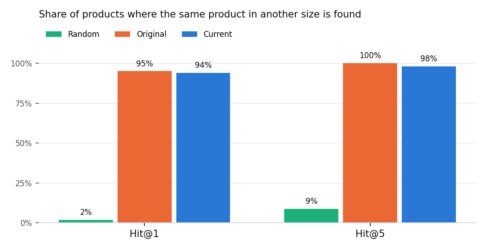

# Skincare Product Recommender

Find skincare products with a similar formula. Pick a product and the app shows up to five similar products of the same type. You can also look for cheaper alternatives or other brands.

**Live app:** [mk-skincare-recommendation.streamlit.app](https://mk-skincare-recommendation.streamlit.app/)

<!-- Add a screenshot or GIF of the app here, for example:  -->

The project has three parts:

1. **A data pipeline** that keeps a catalogue of Lookfantastic products up to date, with data quality checks and a weekly schedule.
2. **A recommender** that matches products on their ingredient lists.
3. **An evaluation** that tests the recommender against a random baseline and published dupe pairs.

## Features

- **Ingredient matching.** Products are compared on their full ingredient lists. Ingredients listed first carry more weight.
- **Ingredient families.** Related ingredients such as sodium hyaluronate and hyaluronic acid get partial credit.
- **Dupe finder.** Show only products that cost less than the one you picked.
- **Other brands only.** Hide products from the same brand.
- **Transparent results.** Each card shows its ingredient match, rating and price with a link to the product page.
- **One listing per product.** Other sizes of the product you picked are hidden. Each result appears once.

## How it works

Every product is compared with all other products of the same type. Each candidate gets a score from three signals.

| Signal | Weight | What it measures |
|---|---|---|
| Ingredient match | 75% | How similar the two formulas are |
| Price | 15% | Similar price by default. In dupe mode a bigger saving scores higher. |
| Rating | 10% | Higher rated products score a little higher |

```
score = 0.75 × ingredient match + 0.15 × price + 0.10 × rating
```

**Ingredient match.** Each full ingredient name is one token. "Sodium hyaluronate" is matched as a whole and is never split into separate words. Water is ignored because nearly every product has it. Ingredient lists are ordered by concentration so the top five ingredients are repeated to give them more weight. TF-IDF then gives rare ingredients more weight than common ones like glycerin. Cosine similarity turns this into a score between 0 and 1.

**Ingredient families.** Fourteen families group related ingredients. Examples are hyaluronic acid, vitamin C, retinoids, ceramides, peptides, AHAs and BHAs. Each ingredient in a family adds a family token with the same weight as the ingredient. Exact matches still score highest. See [`ingredients.py`](ingredients.py).

**Similarity threshold.** A product needs an ingredient match of at least 0.1 to appear. Price and rating cannot push an unrelated product into the results.

**Missing ratings.** Products with no rating get the median rating for their product type.

**Size variants.** Many products are listed in more than one size. Sizes are matched by name so the same product never fills more than one slot.

## Evaluation

The full analysis is in [`notebooks/evaluation.ipynb`](notebooks/evaluation.ipynb). It tests the model three ways against a random baseline.

**1. Size variants.** A product sold in two sizes has the same formula. The model finds the other size as its top match for 94% of products. Random picks would manage 2%.



**2. Published dupes.** Five pairs from beauty editors and dupe finder sites exist in this catalogue. The known alternative has a median rank of 5 out of 98 products. Random picks would give 50. Three of the five appear in the app's top five.

| Model | Median rank | Pairs in the top 5 |
|---|---|---|
| Random | 50 | 0 |
| Original | 11 | 2 |
| Current without families | 7 | 2 |
| Current | 5 | 3 |

**3. Catalogue behaviour.**

| Check | Result |
|---|---|
| Products with at least one cheaper alternative | 90% |
| Median saving in dupe mode | 48% |
| Results that are another size of the same product | 0% (was 2.5%) |
| Results from the same brand | 21% (3.8% if random) |

Same-brand results are common because brands reuse base formulas across their ranges. The "Exclude the same brand" toggle covers this.

## Data pipeline

The app reads `data/skincare_products.csv`. The pipeline in [`pipeline/`](pipeline/) keeps it up to date.

```
category pages ──► discover new products ──┐
                                           ├──► fetch product pages ──► merge ──► quality checks ──► save
existing catalogue ──► re-check products ──┘
```

1. **Discover.** Reads Lookfantastic category pages for each product type and collects product links.
2. **Fetch.** Visits every known and newly found product page. It reads the name, brand, price, rating, review count, image, stock status and full ingredient list. Requests go one at a time with a pause between them.
3. **Merge.** Updates existing products, adds new ones and marks products whose page has gone as unavailable. Products are never deleted. Some sizes share one product page. For those, only fields that are the same for every size are updated.
4. **Check.** Runs data quality checks. If any check fails the catalogue is not saved. Every run writes [`data/quality_report.md`](data/quality_report.md).

| Check | Fails the run when |
|---|---|
| No duplicate products | Two rows share a product ID and name |
| No missing key fields | A product has no ID, name, link or type |
| Product types are known | A type is not one the app supports |
| Prices and ratings in range | A price is not between £0 and £1,000 or a rating is not between 0 and 5 |
| Ingredient coverage | Fewer than 90% of available products have ingredients |
| No products were lost | The catalogue has fewer rows than before |
| Most pages loaded | More than 20% of requests failed, for example if the site blocks the scraper |

Warnings cover short ingredient lists, missing brands and products still using 2021 ingredients.

**Schedule.** [`.github/workflows/refresh-data.yml`](.github/workflows/refresh-data.yml) runs the pipeline every Monday. It runs the tests on the new data and commits the updated catalogue and report. It can also be started by hand from the Actions tab. A second workflow runs the tests on every push.

### Run the pipeline yourself

```bash
pip install -r requirements-pipeline.txt
python -m pipeline.run --limit 20 --no-discover   # quick test on 20 products
python -m pipeline.run                            # full refresh
```

## Data

The catalogue started from a 2021 [Kaggle](https://www.kaggle.com) dataset of [Lookfantastic](https://www.lookfantastic.com) skincare products. In 2026 it was refreshed with current prices, ratings, images and availability. The pipeline now replaces the 2021 ingredient lists with current ones and adds new products.

| | |
|---|---|
| Products | 1,138 |
| Available (shown in the app) | 1,032 |
| Product types | 14 (Mask, Body Wash, Moisturiser, Cleanser, Serum and more) |
| Average ingredients per product | 24 |

**File:** `data/skincare_products.csv`

| Column | Description |
|---|---|
| `product_id` | Lookfantastic product ID. Sizes that share a page share an ID. |
| `product_name` | Name of the product |
| `product_url` | Link to the product page |
| `product_type` | Category such as Moisturiser, Cleanser or Serum |
| `brand` | Brand name |
| `ingredients` | List of ingredients in order of concentration |
| `ingredients_source` | `kaggle_2021` or `lookfantastic` for scraped lists |
| `price` | Price when first seen (£) |
| `updated_price` | Latest price (£). Used in the app. |
| `price_change` | Difference between the two prices |
| `product_rating` | Average customer rating out of 5 |
| `review_count` | Number of reviews |
| `product_image_url` | Product image |
| `available` | Whether the product page still exists |
| `in_stock` | Whether the product was in stock at the last check |
| `first_seen` / `last_checked` | When the product was added and last checked |

`data/skincare_products_2021.csv` and `data/skincare_products_2026.csv` are kept as history. [`notebooks/Skincare.ipynb`](notebooks/Skincare.ipynb) is the original 2026 refresh.

## Project structure

```
skincare_recommendation/
├── recommender.py                     # Streamlit app and recommendation logic
├── ingredients.py                     # Ingredient cleaning and families
├── pipeline/
│   ├── config.py                      # Categories, request settings, check thresholds
│   ├── parse.py                       # HTML parsing (no network)
│   ├── scrape.py                      # Polite fetching and product discovery
│   ├── merge.py                       # Combine scraped data with the catalogue
│   ├── checks.py                      # Data quality checks and report
│   ├── run.py                         # Command line entry point
│   └── bootstrap.py                   # One-off conversion of the 2026 data
├── data/
│   ├── skincare_products.csv          # Catalogue used by the app
│   ├── quality_report.md              # Latest data quality report
│   ├── skincare_products_2026.csv     # 2026 refresh (history)
│   ├── skincare_products_2021.csv     # Original Kaggle dataset (history)
│   └── corrected_brands_dictionary.csv
├── notebooks/
│   ├── evaluation.ipynb               # Model evaluation
│   └── Skincare.ipynb                 # Original 2026 data refresh
├── tests/
│   ├── test_recommender.py
│   ├── test_pipeline.py
│   └── fixtures/                      # Saved pages used by the pipeline tests
├── docs/
│   └── evaluation_size_variants.png
├── .github/workflows/
│   ├── refresh-data.yml               # Weekly data refresh
│   └── tests.yml                      # Tests on every push
├── requirements.txt                   # App dependencies
└── requirements-pipeline.txt          # Pipeline and test dependencies
```

## Run the app locally

```bash
pip install -r requirements.txt
streamlit run recommender.py
```

## Run the tests

```bash
pip install -r requirements-pipeline.txt
pytest
```

## Roadmap

- Run the pipeline on current products and test more published dupe pairs
- Extend the ingredient families, for example sunscreen filters and plant oils
- Add product claims such as hydrating or exfoliating as an extra signal
- Let users tune the signal weights in the app
